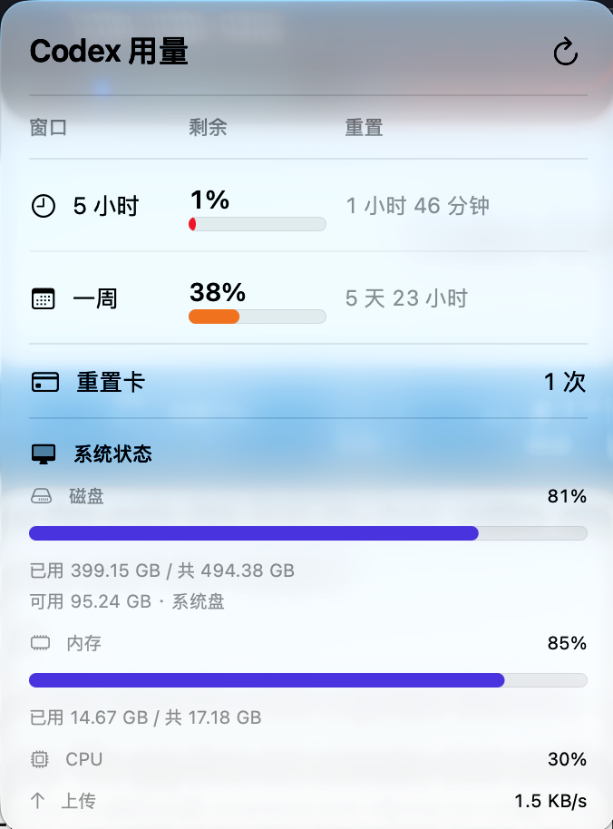
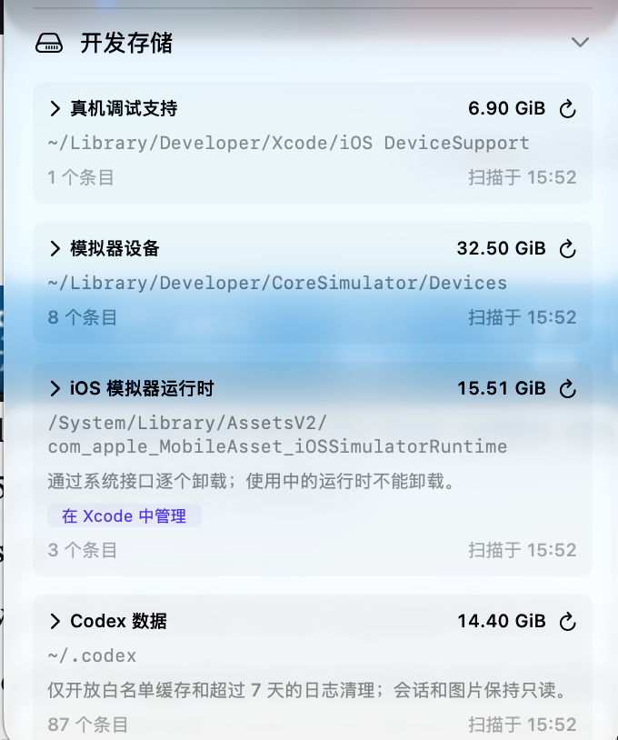

# Codex Usage Status

English | [简体中文](README.zh-CN.md)


| Status Bar | Expand Panel 1 | Expand Panel 2 |
| :---: | :---: | :---: |
|  |  |  |


A native macOS menu bar utility that reads data from the local `codex app-server` and displays:

- Remaining capacity in the 5-hour and 7-day windows
- Time until each window resets
- Available reset credits, shown only when the count is greater than zero

Codex account access is read-only. The app does not consume reset credits or directly read or record Codex authentication files. It also measures local developer storage and offers single-item and batch permanent cleanup with confirmation of the exact item list.

## Requirements

- macOS 13 or later
- Codex CLI installed and signed in with a ChatGPT account

Regular users do not need Xcode. Xcode is only required for development or building the app from source.

The app automatically checks these common Codex CLI locations:

```text
/opt/homebrew/bin/codex
/usr/local/bin/codex
```

You can also select the `codex` executable manually from the app popover.

## Download and install

1. Download the latest `CodexUsageStatus-<version>-macos-universal.zip` from the project releases page.
2. Double-click the ZIP file to extract `CodexUsageStatus.app`.
3. Drag `CodexUsageStatus.app` into the Applications folder.
4. Open `CodexUsageStatus` from Applications.
5. Look for the usage display on the right side of the macOS menu bar.

This is a menu bar app. It does not open a normal window or show an icon in the Dock.

A release signed and notarized by Apple can be opened normally. If you received an ad-hoc signed development build, right-click the app in Finder, choose **Open**, and confirm **Open** again. Only do this for packages from a source you trust.

## First-time setup

### 1. Check the Codex CLI

Open Terminal and run:

```bash
codex --version
```

If a version number appears, the Codex CLI is installed. If Terminal reports `command not found` and Node.js with npm is already installed, use the official installation command:

```bash
npm install --global @openai/codex
```

Sign in with your ChatGPT account:

```bash
codex login
```

Complete the browser sign-in flow, then verify the session:

```bash
codex login status
```

Codex Usage Status reuses the Codex CLI session. You do not need to enter an API key in the app.

> The current version supports Codex signed in with a ChatGPT account. API key and Amazon Bedrock authentication cannot provide the account usage shown by this app.

### 2. Read the menu bar display

The menu bar uses two rows without an added background or outer border, with thin separators between groups. Both windows are shown by default. Light appearance uses dark glyphs; dark appearance uses white glyphs:

- The clock icon identifies the remaining percentage in the 5-hour window. Its second row shows the local 24-hour reset time, such as `18:00`; a next-day reset is marked `明 01:00`.
- The calendar icon identifies the remaining percentage in the weekly window. Its second row shows the reset date as `MM.dd`, such as `11.08`.
- The card icon identifies available reset credits, with **重置卡** on its second row. The **显示重置卡次数** toggle defaults to on. This group is hidden when disabled, zero, or unavailable; the details popover still shows the count.
- `…` means loading. `--%` / `--` means the quota or reset time is unavailable. **待重置** means the reset time has been reached and a backend update is pending. The other window remains visible.

Use **显示模式** (Display mode) to choose **5 小时** (5 hours), **一周** (weekly), or **全部** (both). Changes apply immediately and persist across launches. Hover over the status item for complete reset dates. Date labels and countdowns in the details table update locally once per minute.

### 3. View details

Click the usage display in the menu bar to open the details popover. It includes:

- A compact Window / Remaining / Reset table with percentages, progress bars, and reset countdowns for both windows
- Exact reset dates in countdown tooltips
- Available reset credits
- Last update in the footer, with the next refresh time in its tooltip

Use the refresh button in the upper-right corner to fetch fresh data immediately.

### 4. Configure automatic refresh

Choose one of the available intervals in the **Automatic refresh** section:

- 5 minutes
- 10 minutes, the default
- 30 minutes
- 1 hour

The selection is saved automatically. The app also reconciles usage after the Mac wakes from sleep and when a quota reset is reached.

### 5. Launch at login

After moving the app into Applications, enable **Launch at login** in the details popover. If macOS asks for approval, open:

```text
System Settings → General → Login Items & Extensions
```

### 6. Quit the app

Click the usage display in the menu bar, then click **Quit** at the bottom of the popover.

### Developer storage and batch cleanup

The **Developer storage** section measures these directories independently of Codex login or usage requests:

```text
~/Library/Developer/Xcode/iOS DeviceSupport
~/Library/Developer/CoreSimulator/Devices
/System/Library/AssetsV2/com_apple_MobileAsset_iOSSimulatorRuntime
~/.codex
~/Library/Caches
~/Library/Application Support
/private/tmp
```

Expand a directory to see versions or devices sorted by disk usage, with full paths and modification times. Simulator rows also show the device name, OS version, UDID, and current state. **Show in Finder** opens the item for further inspection. Unrecognized directories and auxiliary files remain visible as read-only items. The popover scrolls to fit the screen. The **Developer storage** section collapses automatically when the popover closes, so it reopens in its initial state.

**User caches** allow cleanup only for directories named with a bundle identifier that resolves to an existing app bundle with the same identifier. Processes inside that bundle, including helper apps, block cleanup; unknown ownership or unavailable process information keeps the entry read-only. **Application Support** is always read-only: an app missing from LaunchServices does not prove it was uninstalled, and its data may still be valuable.

**System temporary files** allow only regular files and directories whose entire tree belongs to the current user and was last modified more than three days ago. Symlinks, special files, mount points, directories writable by group/others, recent descendants, and incomplete checks block cleanup. Eligible entries show **Meets cleanup conditions**, rather than a guarantee of safety. Modification time does not prove an item is unused. Exact targets require confirmation and fresh identity/occupancy checks. These checks are snapshots: an app can start or reopen a file afterwards, and path validation plus removal is not atomic against concurrent replacement by another process. No automatic retry is performed.

**iOS simulator runtimes** measure only the specified AssetsV2 directory without adding mounted-volume capacity. Asset metadata supplies version/build labels. The app uses `simctl runtime list --json` to match each package to exactly one system identifier. **Uninstall runtime** is enabled only for a ready, system-deletable runtime whose associated devices are known to be idle. Each runtime requires its own confirmation, listing affected devices and explaining that the runtime must be installed again to use them. Filesystem identity and live state are rechecked before `simctl runtime delete <identifier>`; the app never raw-deletes AssetsV2 data, explicitly shuts down a device, or automatically retries. If tools, permissions, or mapping checks fail, **Manage in Xcode** opens Xcode; continue to Settings → Components. Remaining assets are reported without falling back to filesystem deletion.

**Codex data** shows archived sessions (`archived_sessions`), generated images (`generated_images`), sessions (`sessions`), and other child sizes. Only file metadata is measured; authentication, session, database, and image contents are not read. **View cleanup candidates** on `cache` or `log` loads individual eligible files on demand, with checkboxes, Select all, and Deselect all:

- Cache cleanup includes only immediate regular `.json` files in `cache/codex_apps_server_info`, `cache/codex_apps_tools`, and `cache/remote_plugin_catalog`.
- Log cleanup includes only regular `.log` files, numbered rotations, and their `.gz` forms under `log`, modified more than seven days ago.
- Archived sessions, generated images, SQLite/WAL/SHM, authentication, settings, plugins, worktrees, and unknown caches remain protected. Parent directories are retained.

File cleanup confirms exact paths, sizes, and modification times. Caches may regenerate; deleted logs cannot be used for historical troubleshooting. Identity and exact-path `lsof` checks run immediately before deletion. Changes, occupancy, symlinks, or incomplete checks stop that item. Refreshing Codex measurements invalidates loaded candidates and their selection; reload them to continue.

Scanning starts when the popover first opens. Reopening refreshes results older than five minutes; each directory also has a manual refresh button. Directory walks run serially in the background; routine Runtime/Codex/Application Support monitoring and ineligible app caches do not retain recursive identity manifests; evidence is prepared only for a requested runtime uninstall or candidate file list, reducing memory usage. Storage does not follow the Codex refresh schedule. Sizes use MiB/GiB. Permission failures are reported as incomplete scans rather than zero usage, and retained results from failed refreshes are marked stale.

When a scan encounters a permission-denied error, the storage panel offers **Open authorization settings**, **Show this app in Finder**, and **Rescan after authorization**. In System Settings → Privacy & Security → Full Disk Access, add and enable the running app. macOS stores the authorization; the app does not repeatedly open permission dialogs or store an assumed authorization flag. You may need to quit and reopen the app before rescanning. Full Disk Access cannot be granted programmatically and does not override ordinary file permissions or every system protection. Keeping a stable signed app identity avoids unnecessary reauthorization between builds. See [Apple's file-permission guidance](https://developer.apple.com/forums/thread/678819).

Physical-path validation uses POSIX `realpath`, avoiding Foundation's convenience rewriting of `/private/tmp` to `/tmp`. Actual symlink roots, mount points, and target replacements remain blocked; a safety-validation failure does not trigger the permission guide.

Cleanup compares fresh filesystem identities directly with the confirmed manifest and stops at the first mismatch, without constructing a second recursive manifest. Library cleanup (single or batch) scans the category only afterwards to update the display; its category-wide size reduction is intentionally unavailable, while volume free-space changes are still measured. Other categories use a metadata-only pre-cleanup size measurement without rebuilding manifests or querying simulator state. Batch cleanup shares these category measurements across all selected items. Occupancy checks and final live-state checks remain in place; large trees can still take time to verify or delete.

- **Permanently delete** removes only the selected DeviceSupport version. Debugging a matching physical device may later require regenerating or downloading support files.
- **Delete device** uses `simctl delete <UDID>` for exactly one simulator, permanently removing its installed apps and local data. OS runtimes are unaffected. Recreate the device if needed.

Expand a directory to select multiple eligible items using checkboxes. Each group offers **Select all** and **Deselect all**; selection skips items that cannot be cleaned. DeviceSupport, simulator devices, eligible user caches, temporary items, and Codex candidate files support batch selection; runtime uninstalls are individual. **Delete selected** opens a scrollable confirmation list of all exact targets; canceling preserves the selection. Refreshing automatically deselects changed or missing items. Individual cleanup buttons remain available.

Shutdown simulators and incomplete `Creating` devices explicitly reported as unavailable by `simctl` support both individual and batch deletion. Available devices still being created, booting, running, shutting down, or lacking verified live identity remain ineligible.

Every action requires confirmation of the exact target list. DeviceSupport and simulator-device directory cleanup revalidates paths, directory and descendant identities, and device state, then checks descendant occupancy with `lsof +D`. Codex file cleanup checks the exact file path; runtime uninstalls revalidate the system management identifier and associated device state. Changed targets, running or unknown device states, symbolic-link targets, mount points, and incomplete occupancy checks block cleanup. The app never automatically shuts down a device, retries deletion, or falls back to raw simulator-directory deletion.

Live simulator status and deletion require Xcode and a correctly selected developer directory. Disk measurements remain available when tools or CoreSimulator services are unavailable, but device deletion is disabled.

Batch cleanup runs serially in the background with progress, avoiding competing disk operations. Each affected parent directory is scanned only once before and once after the batch, and available space is measured once per shared volume. During execution, only the current target is revalidated; the list updates when the batch finishes. Failed items are not retried; other confirmed targets proceed independently, and every result is reported.

After cleanup, the app separately reports measured directory usage reduction and the change in available volume space. Closing the popover or expanding/collapsing either directory clears cleanup result messages. In-flight cleanup continues and updates storage measurements, but dismissed results do not reappear. APFS shared blocks, snapshots, and other processes can affect those numbers; measured usage is not guaranteed reclaimable space. Keep any device data you still need.

## System monitoring

The popover's System Status section shows startup disk capacity, estimated used memory, whole-machine CPU utilization, and upload/download speeds for the primary network interface. Monitoring works independently of Codex CLI, including when signed out or when quota requests fail. **Developer storage**, **System Status**, and **System Monitoring Settings** appear together in that order; all three sections start collapsed, and clicking a header row expands or collapses it. Each collapses automatically when the popover closes.

System Monitoring Settings provides separate **menu bar** and **details** switches for each of the five metrics. Changes take effect immediately and persist across launches. By default, all details are enabled and all menu bar metrics are disabled. Enabled menu bar metrics appear in disk, memory, CPU, network order. Upload and download share one column, with upload (↑) above download (↓); enabling only one shows just that row. Choose only the metrics that fit your menu bar.

- Choose a **1, 2, or 5 second** system refresh interval (default: **2 seconds**), independently of Codex's 5/10/30/60 minute quota refresh.
- Disk capacity refreshes every **30 seconds**, reading the startup data volume without scanning directories. External disks and disk I/O speeds are not included.
- Estimated used memory is anonymous pages minus purgeable pages, plus wired pages and the compressor's resident pages, multiplied by the actual page size. It can differ from Activity Monitor because of accounting and sampling time.
- CPU utilization uses busy/total tick deltas across samples and is normalized to **0–100%** for the whole machine.
- Upload and download use byte-counter deltas and actual monotonic elapsed time, displayed in decimal B/s, KB/s, MB/s, or GB/s. The primary IPv4 interface is preferred, with IPv6 as fallback. Physical and VPN interfaces are never added together; the selected interface name appears in details.
- CPU and network speeds wait for an initial baseline. Interface changes, counter resets, and wake from sleep establish a new baseline; no primary interface is shown as disconnected. A failed metric shows its reason without blocking others.
- Menu bar metrics continue sampling with the popover closed. Details-only metrics are sampled only while the popover is open. No sampling occurs when all metrics are disabled; settings remain accessible.

System metrics stay on this Mac: no uploads, history storage, or administrator privileges are required.


## Troubleshooting

### “Codex CLI not found”

Run `codex --version` in Terminal first. If Terminal can find it but the app cannot:

1. Open the app popover.
2. Click the gear in the lower-right corner to expand **Codex CLI** settings.
3. Click **Choose…**.
4. Select the actual `codex` executable.

Common locations:

```text
/opt/homebrew/bin/codex
/usr/local/bin/codex
```

### “Sign in with a ChatGPT account first”

Run:

```bash
codex login
```

After signing in, return to the app and click the refresh button.

### Nothing appears in the menu bar

- Open Activity Monitor and search for `CodexUsageStatus` to confirm that it is running.
- If the menu bar is full, quit some other menu bar utilities.
- Remember that this app does not appear in the Dock.

### Usage does not change

- Click the refresh button in the details popover.
- Check that the Codex CLI is still signed in.
- Check whether automatic refresh is set to 1 hour.
- When existing data becomes stale, the app retries with bounded delays of 1, 2, 5, 10, and 30 seconds.

### Launch at login does not work

Confirm that the app is in the Applications folder, then turn **Launch at login** off and on again. If it still fails, check **System Settings → General → Login Items & Extensions** for a pending approval.

## Build and test

Development requires Xcode 26 because the project uses Swift 6. Regular users do not need to run these commands.

```bash
xcodebuild \
  -project CodexUsageStatus.xcodeproj \
  -scheme CodexUsageStatus \
  -destination 'platform=macOS' \
  -derivedDataPath /tmp/codex-usage-status-derived \
  CODE_SIGNING_ALLOWED=NO \
  build

xcodebuild \
  -project CodexUsageStatus.xcodeproj \
  -scheme CodexUsageStatus \
  -destination 'platform=macOS' \
  -derivedDataPath /tmp/codex-usage-status-derived \
  CODE_SIGNING_ALLOWED=NO \
  test
```

To run the optional integration test against the locally installed Codex CLI:

```bash
xcodebuild \
  -project CodexUsageStatus.xcodeproj \
  -scheme CodexUsageStatus \
  -destination 'platform=macOS' \
  -derivedDataPath /tmp/codex-usage-status-derived \
  CODE_SIGNING_ALLOWED=NO \
  'SWIFT_ACTIVE_COMPILATION_CONDITIONS=$(inherited) CODEX_INTEGRATION_TESTS' \
  -only-testing:CodexUsageStatusTests/ProtocolDecodingTests/testLiveCodexAppServerWhenEnabled \
  test
```

To use **Launch at login** in a local build, build with **Sign to Run Locally**, move the app into `/Applications`, and then enable the setting.

## Create a release package

Run:

```bash
./scripts/package-release.sh
```

The script creates a Release build and writes these files to `dist/`:

```text
CodexUsageStatus.app
CodexUsageStatus-0.1.0-macos-universal.zip
CodexUsageStatus-0.1.0-macos-universal.zip.sha256
```

The ZIP supports both Apple silicon and Intel Macs. Without a distribution certificate, the script uses an ad-hoc signature. This is suitable for local testing or trusted distribution, but macOS will show a security warning on first launch.

For public distribution, sign with a Developer ID Application certificate and submit the app to Apple for notarization:

```bash
DEVELOPER_ID_APPLICATION="Developer ID Application: Your Name (TEAMID)" \
NOTARYTOOL_PROFILE="codex-usage-status-notary" \
./scripts/package-release.sh
```

`NOTARYTOOL_PROFILE` is the profile name previously stored in Keychain with `xcrun notarytool store-credentials`. After signing and notarization, upload the ZIP and `.sha256` file to the project releases page. Users can then install the app without Xcode.

## Refresh behavior

- Available intervals are 5 minutes, 10 minutes, 30 minutes, and 1 hour; the default is 10 minutes.
- Reset countdowns in the details table update locally once per minute without making a network request.
- A manual refresh recalculates the next scheduled refresh.
- The app reconciles usage when either window resets or after waking from sleep with stale data.
- `account/rateLimits/updated` notifications merge usage fields locally and do not bypass the selected polling interval.
