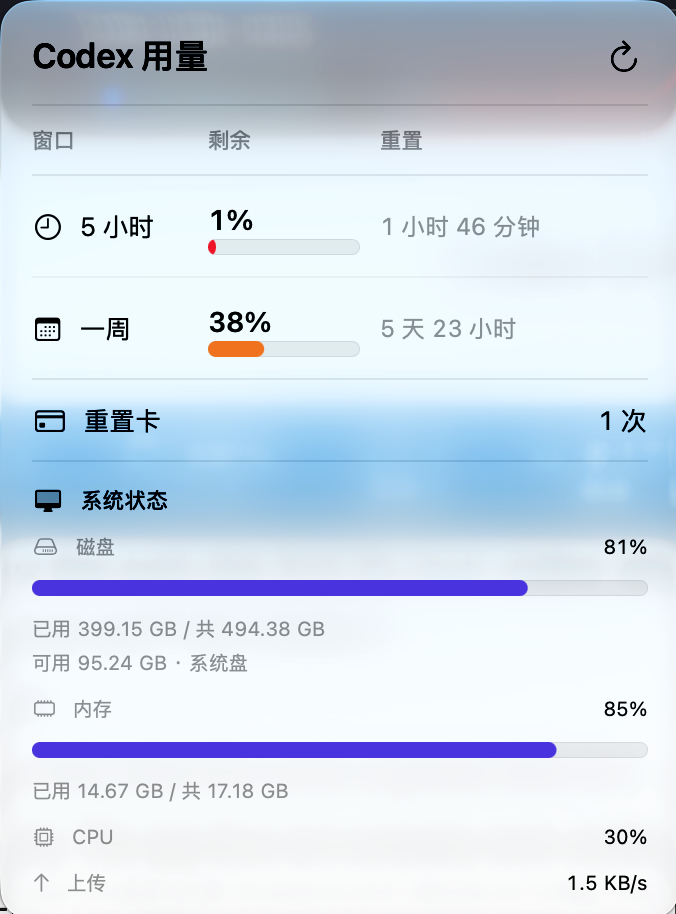
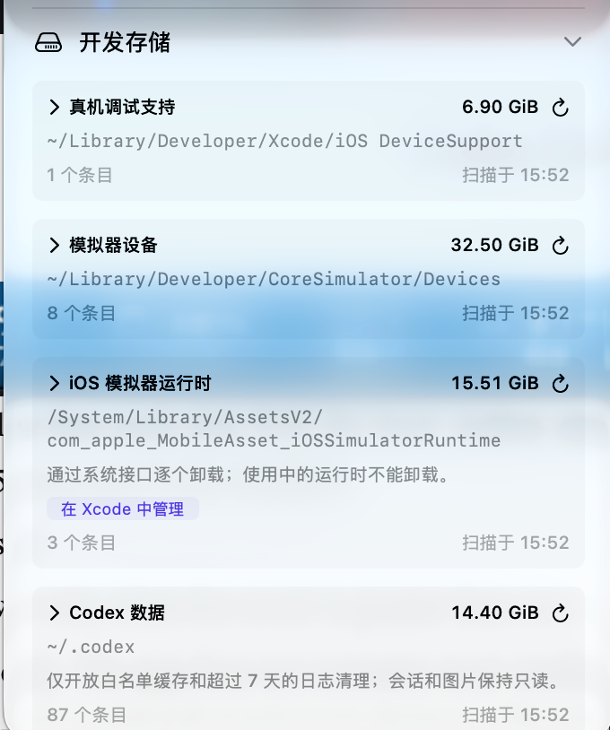

# Codex Usage Status

English | [简体中文](README.zh-CN.md)

A native macOS menu bar app for Codex usage, developer storage cleanup, and system monitoring.

- See remaining quota and reset times for the 5-hour and weekly windows, plus available reset credits.
- Inspect developer storage and confirm individual or batch cleanup.
- Show disk, memory, CPU, and network metrics in the menu bar or details panel.

Codex usage comes from the local `codex app-server`. Account access is read-only: the app reuses your CLI login, does not consume reset credits, and does not directly read or record authentication files.

| Menu bar | Usage panel | Storage panel |
| :---: | :---: | :---: |
|  |  |  |

## Install

Requires **macOS 13+**. Codex usage requires the Codex CLI signed in with a **ChatGPT account**; API key and Amazon Bedrock logins are not supported. Storage and system monitoring work independently of Codex login. Xcode is needed only for building the app and managing simulators.

1. Download `CodexUsageStatus-<version>-macos-universal.zip` from [Releases](https://github.com/zhiqiang21/codex-usage-status/releases). It supports Apple silicon and Intel Macs.
2. Extract the ZIP, move `CodexUsageStatus.app` to Applications, and open it.
3. Look for the app in the menu bar. It has no Dock icon or standalone window.

If the CLI is not installed, install it with npm (requires Node.js), then sign in:

```bash
npm install --global @openai/codex
codex login
codex login status
```

The app detects `/opt/homebrew/bin/codex` and `/usr/local/bin/codex`. For another location, click the gear in the panel and select the executable under Codex CLI settings. No API key is needed in the app.

Development builds use ad-hoc signing and may trigger macOS security warnings.

## Usage

The app UI is currently in Chinese. Control names below are English translations; Chinese text is quoted where it helps identify a label.

| Icon | Top row | Bottom row |
| --- | --- | --- |
| Clock | 5-hour quota remaining | Local reset time, e.g. `18:00`; `明 01:00` means tomorrow at 01:00 |
| Calendar | Weekly quota remaining | Reset date (`MM.dd`) |
| Card | Available reset credits | Earliest future expiration date returned for available credits (`MM.dd`), or `--` if absent |

Hover for full dates. Reset credits are hidden in the menu bar when disabled, zero, or unavailable. The details panel hides zero credits and shows unknown values as `未知`. `…` means loading, `--%` / `--` means unavailable, and `待重置` means a reset is due and awaiting a server update.

Click the menu bar display to see quota details and settings:

- **Display mode** (`显示模式`): show the 5-hour window, weekly window, or both. **Show reset credits** (`显示重置卡次数`) is on by default.
- **Automatic refresh**: 5, 10, 30, or 60 minutes; default **10 minutes**. The refresh button fetches data immediately. The app also reconciles usage at quota resets and after waking with stale data.
- **Launch at login**: enable after moving the app to Applications. Check System Settings → General → Login Items & Extensions if approval is needed.
- **Quit**: use the button at the bottom of the panel.

Settings persist across launches. Countdown and date labels update locally once per minute; server notifications merge into existing data without extra polling.

## Developer storage

Expand a category to view items sorted by size, inspect paths and modification times, or reveal an item in Finder. Scans run in the background when the panel first opens; reopening refreshes results older than **5 minutes**. Manual refresh is available per category. Failed or partial scans are marked instead of shown as zero usage.

| Category / path | Cleanup available |
| --- | --- |
| Device support — `~/Library/Developer/Xcode/iOS DeviceSupport` | Selected versions; support files may need to be downloaded again for device debugging |
| Simulator devices — `~/Library/Developer/CoreSimulator/Devices` | Shut-down devices and verified unavailable `Creating` remnants; deletes their apps and local data, not OS runtimes |
| Simulator runtimes — `/System/Library/AssetsV2/com_apple_MobileAsset_iOSSimulatorRuntime` | Individual uninstall through `simctl`, when the runtime is ready, system-deletable, and associated devices are idle |
| Codex data — `~/.codex` | Selected cache JSON files and logs older than 7 days; see below |
| User caches — `~/Library/Caches` | Verified app cache directories while the owning app and its helpers are not running |
| Application support — `~/Library/Application Support` | Read-only |
| Temporary files — `/private/tmp` | Eligible files and directories owned by the current user, with no descendants modified in the last 3 days |

For Codex data, **View cleanup candidates** loads files under `cache` or `log`. Cache cleanup is limited to immediate `.json` files in `cache/codex_apps_server_info`, `cache/codex_apps_tools`, and `cache/remote_plugin_catalog`. Log cleanup covers `.log` files, numbered rotations, and their `.gz` forms older than 7 days. Sessions, generated images, databases, authentication, settings, plugins, worktrees, and unknown caches are protected. Scans read metadata, not file contents. Caches may regenerate; deleted logs are no longer available for troubleshooting.

Select eligible items and choose **Delete selected**, or use an individual cleanup button. Every operation requires confirmation of the exact targets. Batch cleanup runs serially and reports each result; runtime uninstalls require separate confirmation. Deletion is permanent. Removing a runtime requires reinstalling it before its devices can be used again.

Before cleanup, the app rechecks target identity, paths, occupancy, and applicable device state. Changed targets, symlinks, mount points, or incomplete checks block deletion. The app does not shut down devices, retry failed deletions, or fall back to deleting simulator folders directly. These checks reflect a point in time; eligibility does not prove data is no longer needed.

Sizes use MiB/GiB and allocated disk space. Cleanup reports measured usage and volume free-space changes where available; APFS sharing, snapshots, and other processes mean these may differ from the listed size.

Each category has a **Week / Month** size chart covering up to 30 days. History stays local, uses complete scans without extra polling, and does not store directory contents or child paths. Failed scans are not recorded as zero.

If a scan reports permission denied, use the panel's authorization controls to add the running app under System Settings → Privacy & Security → Full Disk Access. You may need to reopen the app before rescanning. This does not override all filesystem protections. Simulator management also requires Xcode and a correctly selected developer directory; use Xcode → Settings → Components if runtime uninstall is unavailable.

## System monitoring

View startup disk capacity, estimated used memory, whole-machine CPU usage (0–100%), and upload/download speeds for the primary network interface. Memory accounting may differ from Activity Monitor; network speeds show one interface, without adding physical and VPN traffic together.

In **System Monitoring Settings**, each metric has separate menu bar and details switches. Details are on by default; menu bar metrics are off. Upload (↑) and download (↓) share a menu bar column.

- Refresh every **1, 2, or 5 seconds**, default **2 seconds**. Disk capacity updates every **30 seconds**.
- Menu bar metrics keep sampling while the panel is closed; details-only metrics sample while it is open. Disabling all metrics stops sampling.
- CPU and network speeds need an initial sample and reset their baseline after wake or interface changes.

Metrics stay on this Mac, with no uploads or saved history. Storage and monitoring sections collapse when the panel closes.

## Troubleshooting

| Problem | What to check |
| --- | --- |
| CLI not found | Run `codex --version`; use the panel's gear to select the executable if needed |
| Sign-in required | Run `codex login`, then refresh the panel |
| No menu bar display | Check Activity Monitor for `CodexUsageStatus` and make room in the menu bar |
| Usage not updating | Refresh manually, check `codex login status` and the refresh interval; connection failures use bounded retries |
| Launch at login fails | Move the app to Applications, toggle the setting, and check macOS Login Items approval |

## Build and test

Requires **Xcode 26 / Swift 6**. The app targets macOS 13+; tests require macOS 14+.

```bash
xcodebuild -project CodexUsageStatus.xcodeproj \
  -scheme CodexUsageStatus -destination 'platform=macOS' \
  -derivedDataPath /tmp/codex-usage-status-derived \
  CODE_SIGNING_ALLOWED=NO build
```

Replace `build` with `test` to run tests. The optional live Codex integration test requires a local CLI login and explicit opt-in:

```bash
xcodebuild -project CodexUsageStatus.xcodeproj \
  -scheme CodexUsageStatus -destination 'platform=macOS' \
  -derivedDataPath /tmp/codex-usage-status-derived \
  CODE_SIGNING_ALLOWED=NO \
  'SWIFT_ACTIVE_COMPILATION_CONDITIONS=$(inherited) CODEX_INTEGRATION_TESTS' \
  -only-testing:CodexUsageStatusTests/ProtocolDecodingTests/testLiveCodexAppServerWhenEnabled \
  test
```

For launch-at-login testing, build with **Sign to Run Locally** and place the app in `/Applications`.

## Package a release

```bash
./scripts/package-release.sh                 # Universal (default)
./scripts/package-release.sh --arch arm64    # Apple silicon
./scripts/package-release.sh --arch x86_64   # Intel
```

The script writes the app, ZIP, and `.sha256` checksum under `dist/`. Single-architecture apps use `dist/arm64/` or `dist/x86_64/`; the Universal app uses `dist/CodexUsageStatus.app`. Rebuilding replaces the corresponding outputs.

Without a certificate, builds are ad-hoc signed. For public distribution, provide a Developer ID Application certificate and a notarization profile already saved in Keychain with `xcrun notarytool store-credentials`:

```bash
DEVELOPER_ID_APPLICATION="Developer ID Application: Your Name (TEAMID)" \
NOTARYTOOL_PROFILE="codex-usage-status-notary" \
./scripts/package-release.sh
```
