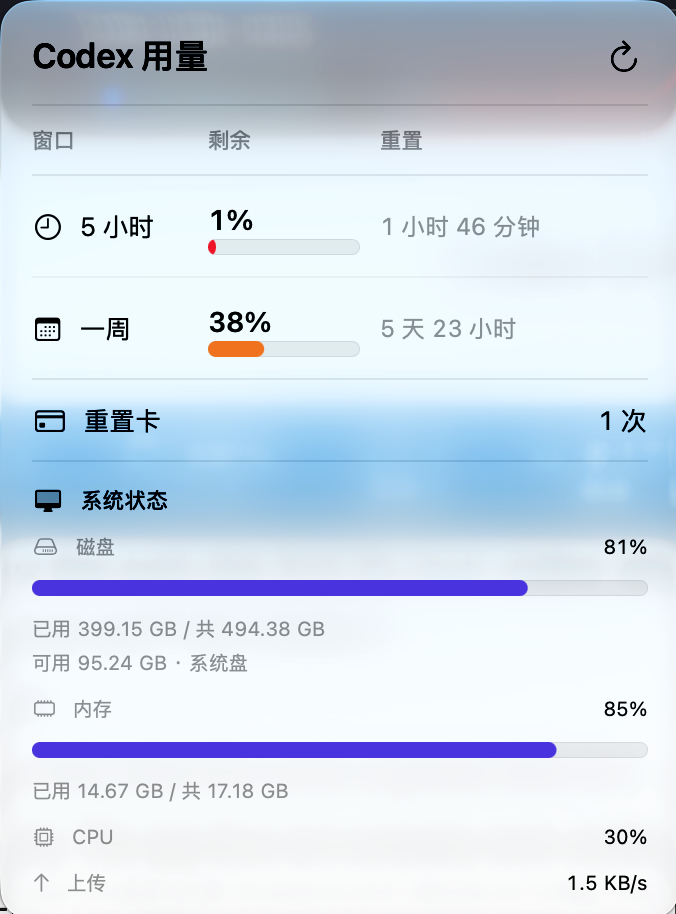
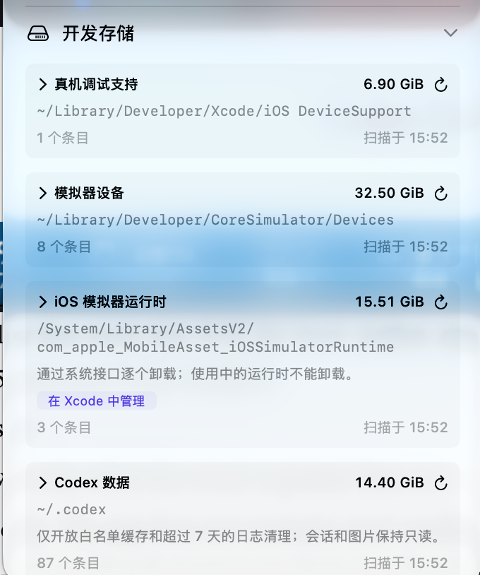

# Codex Usage Status

[English](README.md) | 简体中文

原生 macOS 菜单栏工具，用于查看 Codex 用量、清理开发存储和监控系统状态。

- 查看 5 小时和一周的剩余额度、重置时间及可用重置卡。
- 查看开发目录占用，确认后单项或批量清理。
- 在菜单栏或详情面板显示磁盘、内存、CPU 和网速。

用量数据来自本机 `codex app-server`，复用 CLI 登录状态。账户查询只读，不消费重置卡，不直接读取或记录认证文件。

| 菜单栏 | 用量面板 | 存储面板 |
| :---: | :---: | :---: |
|  |  |  |

## 安装

需要 **macOS 13+**。查看 Codex 用量需安装 Codex CLI，并通过 **ChatGPT 账户**登录；不支持 API Key 和 Amazon Bedrock 登录。存储和系统监控不依赖 Codex 登录。只有编译应用和管理模拟器时需要 Xcode。

1. 从 [Releases](https://github.com/zhiqiang21/codex-usage-status/releases) 下载 `CodexUsageStatus-<version>-macos-universal.zip`，同时支持 Apple 芯片和 Intel Mac。
2. 解压，将 `CodexUsageStatus.app` 移到“应用程序”并打开。
3. 到菜单栏查看用量。应用没有 Dock 图标或独立窗口。

尚未安装 CLI 时，可通过 npm 安装（需要 Node.js），然后登录：

```bash
npm install --global @openai/codex
codex login
codex login status
```

应用自动检测 `/opt/homebrew/bin/codex` 和 `/usr/local/bin/codex`。安装在其他位置时，点击面板齿轮，在“Codex CLI”设置中选择可执行文件。应用内无需填写 API Key。

开发构建使用 ad-hoc 签名，打开时可能遇到 macOS 安全提示。

## 使用

| 图标 | 上行 | 下行 |
| --- | --- | --- |
| 时钟 | 5 小时剩余额度 | 本机时区的重置时刻，如 `18:00`；`明 01:00` 表示次日 01:00 |
| 日历 | 一周剩余额度 | 重置日期（`MM.dd`） |
| 卡片 | 可用重置卡次数 | 返回数据中最近一张尚未到期的可用卡到期日期（`MM.dd`），未提供时显示 `--` |

悬停可查看完整日期。菜单栏中的重置卡在关闭显示、数量为零或未知时隐藏；详情面板在数量为零时隐藏，不可用时显示“未知”。`…` 表示读取中，`--%` / `--` 表示数据不可用，“待重置”表示已到重置时间，等待服务端更新。

点击菜单栏用量可查看详情和设置：

- **显示模式**：选择“5 小时”“一周”或“全部”。**显示重置卡次数**默认开启。
- **自动刷新**：可选 5、10、30、60 分钟，默认 **10 分钟**。右上角按钮可立即刷新；到达配额重置时间或唤醒后数据过期时也会校准。
- **登录时启动**：移到“应用程序”后开启；若需批准，到系统设置 → 通用 → 登录项与扩展中检查。
- **退出**：点击面板底部的退出按钮。

设置自动保存。倒计时和日期每分钟在本地更新，服务端通知直接合并到现有数据，不增加轮询。

## 开发存储

展开类别可按占用大小查看条目、路径和修改时间，也可在 Finder 中定位。首次打开面板时在后台扫描；再次打开时刷新超过 **5 分钟**的结果，各类别也可手动刷新。失败或不完整的扫描会明确标记，不显示为零占用。

| 类别 / 路径 | 可清理范围 |
| --- | --- |
| 真机支持文件 — `~/Library/Developer/Xcode/iOS DeviceSupport` | 选中的版本；后续调试对应真机时可能需要重新下载 |
| 模拟器设备 — `~/Library/Developer/CoreSimulator/Devices` | 已关闭设备，以及经核实不可用的 `Creating` 残留；删除设备应用和本地数据，不删除系统运行时 |
| 模拟器运行时 — `/System/Library/AssetsV2/com_apple_MobileAsset_iOSSimulatorRuntime` | 通过 `simctl` 逐个卸载；须状态就绪、系统允许删除且关联设备空闲 |
| Codex 数据 — `~/.codex` | 指定缓存 JSON 文件和超过 7 天的日志，详见下文 |
| 用户缓存 — `~/Library/Caches` | 归属已核实，且所属应用和辅助进程均未运行的缓存目录 |
| 应用支持数据 — `~/Library/Application Support` | 只读 |
| 系统临时文件 — `/private/tmp` | 属于当前用户、整棵目录树超过 3 天未修改且通过检查的文件和目录 |

Codex 的 `cache`、`log` 条目可通过“查看可清理项”加载文件。缓存仅限 `cache/codex_apps_server_info`、`cache/codex_apps_tools`、`cache/remote_plugin_catalog` 下直属的 `.json` 文件；日志仅限超过 7 天的 `.log`、数字编号轮转日志及对应 `.gz` 文件。会话、生成图片、数据库、认证、配置、插件、工作树和未知缓存不开放清理。扫描只读取元信息，不读取文件内容。缓存可能重新生成，日志删除后无法用于历史排障。

勾选条目后点击“删除所选”，或使用单项清理按钮。每次操作都需确认具体清单；批量清理串行执行，逐项报告结果，运行时需单独确认。**删除不可恢复**；卸载运行时后，需重新安装才能使用关联设备。

执行前会复核目标身份、路径、占用及相关设备状态。目标变化、符号链接、挂载点或检查不完整时停止删除；不会自动关闭设备、重试删除或改为直接删除模拟器文件夹。检查只反映当时状态，符合清理条件不代表数据已无用途。

占用按实际分配空间统计，使用 MiB/GiB。清理后在可测量时分别显示目录占用和卷可用空间的变化；受 APFS 共享块、快照和其他进程影响，这些数字可能与条目大小不同。

各类别提供“周／月”体积趋势，最多保留 30 天。历史只保存在本机，复用完整扫描，不增加轮询，也不保存目录内容或子项路径。失败扫描不会记为零。

遇到权限拒绝时，可通过面板的授权入口，到系统设置 → 隐私与安全性 → 完全磁盘访问权限中添加当前应用，再重新打开并扫描。该权限不能绕过所有文件系统保护。模拟器管理还需要 Xcode 和正确的开发者目录；运行时无法卸载时，可前往 Xcode → Settings → Components 管理。

## 系统监控

显示系统盘容量、内存已用估算、整机 CPU 利用率（0–100%），以及主要联网接口的上传和下载速度。内存统计可能与活动监视器不同；网速只显示一个接口，不叠加物理接口和 VPN 流量。

“系统监控设置”为每项指标提供独立的“菜单栏”和“详情”开关，默认详情开启、菜单栏关闭。上传（↑）和下载（↓）共用一栏。

- 刷新间隔可选 **1、2、5 秒**，默认 **2 秒**；系统盘容量每 **30 秒**更新。
- 菜单栏指标持续采集；仅详情开启的指标只在面板打开时采集，全部关闭后停止采集。
- CPU 和网速需要初始采样，唤醒或切换接口后重新建立基线。

系统指标不上传、不保存历史。关闭面板后，存储和监控区块自动折叠。

## 常见问题

| 问题 | 检查方式 |
| --- | --- |
| 找不到 CLI | 运行 `codex --version`；必要时通过面板齿轮手动选择可执行文件 |
| 提示需要登录 | 运行 `codex login`，然后刷新面板 |
| 菜单栏没有显示 | 在活动监视器中确认 `CodexUsageStatus` 正在运行，并检查菜单栏是否有足够空间 |
| 用量不更新 | 手动刷新，检查 `codex login status` 和刷新间隔；断线后会有限重试 |
| 登录时启动无效 | 确认应用位于“应用程序”，重新切换开关，并检查 macOS 登录项是否需要批准 |

## 构建与测试

需要 **Xcode 26 / Swift 6**。应用最低支持 macOS 13，测试需要 macOS 14+。

```bash
xcodebuild -project CodexUsageStatus.xcodeproj \
  -scheme CodexUsageStatus -destination 'platform=macOS' \
  -derivedDataPath /tmp/codex-usage-status-derived \
  CODE_SIGNING_ALLOWED=NO build
```

将 `build` 改为 `test` 可运行测试。真实 Codex 集成测试需要本机 CLI 已登录，并显式启用：

```bash
xcodebuild -project CodexUsageStatus.xcodeproj \
  -scheme CodexUsageStatus -destination 'platform=macOS' \
  -derivedDataPath /tmp/codex-usage-status-derived \
  CODE_SIGNING_ALLOWED=NO \
  'SWIFT_ACTIVE_COMPILATION_CONDITIONS=$(inherited) CODEX_INTEGRATION_TESTS' \
  -only-testing:CodexUsageStatusTests/ProtocolDecodingTests/testLiveCodexAppServerWhenEnabled \
  test
```

测试登录时启动时，使用 **Sign to Run Locally** 构建，并将应用放入 `/Applications`。

## 发布打包

```bash
./scripts/package-release.sh                 # 默认 Universal
./scripts/package-release.sh --arch arm64    # Apple 芯片
./scripts/package-release.sh --arch x86_64   # Intel
```

脚本将应用、ZIP 和 `.sha256` 校验文件写入 `dist/`。单架构应用放在 `dist/arm64/` 或 `dist/x86_64/`，Universal 应用放在 `dist/CodexUsageStatus.app`。重复构建会覆盖对应产物。

未配置证书时使用 ad-hoc 签名。公开分发时，传入 Developer ID Application 证书，以及已通过 `xcrun notarytool store-credentials` 存入钥匙串的公证配置：

```bash
DEVELOPER_ID_APPLICATION="Developer ID Application: Your Name (TEAMID)" \
NOTARYTOOL_PROFILE="codex-usage-status-notary" \
./scripts/package-release.sh
```
